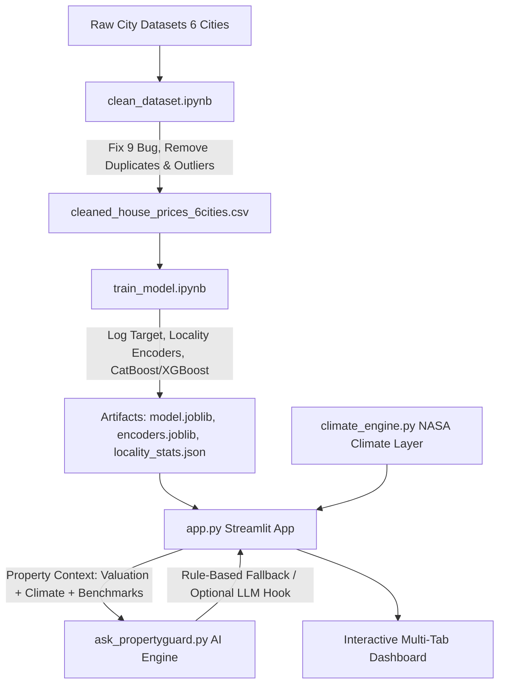

# 🏠 PropertyGuard — Climate & Sustainability-Aware Real Estate Intelligence

> **Predict property prices with Machine Learning, quantify NASA microclimate risks, and consult a grounded Conversational AI Assistant.**

---

## 🌟 Overview

**PropertyGuard** is an end-to-end Machine Learning and Climate Analytics platform tailored for Indian metro real estate markets (**Bangalore, Chennai, Delhi, Hyderabad, Kolkata, and Mumbai**). It bridges property valuation with environmental sustainability to give home buyers a complete, forward-looking view of their prospective investment.

### Key Capabilities:
1. **💰 Accurate Machine Learning Valuation**: Ensembles of CatBoost, XGBoost, and HistGradientBoosting trained on 29,000+ cleaned property records with amenity density and smoothed target encodings.
2. **🌍 NASA Microclimate & Sustainability Engine**: Localized climate risk analysis using NASA POWER indicators (Solar Insolation, Urban Heat Island / Summer Temps, Monsoon Flood Risk, Air Quality).
3. **💡 Actionable Homebuyer Advice**: Automated recommendations for rooftop solar ROI, rainwater harvesting, HVAC thermal insulation, and an interactive due-diligence checklist.
4. **🤖 Ask PropertyGuard (Conversational AI)**: Grounded AI Advisor answering buyer questions directly from computed valuation and climate data (zero hallucination).

---

## 🏗️ System Architecture



---

## 📁 Repository Structure

```text
PrpertyGuard/
├── app.py                         # Interactive Streamlit Web Application (Tabs 1–4)
├── climate_engine.py              # NASA Microclimate & Sustainability Scoring Engine
├── ask_propertyguard.py           # Conversational AI Assistant (rule-based + LLM hook)
├── clean_dataset.ipynb            # Data cleaning, outlier filtering & EDA
├── train_model.ipynb              # Model training, cross-validation & evaluation
├── encoders.joblib                # Serialized categorical & locality encoders
├── locality_stats.json            # Locality median price benchmarks
├── model.joblib                   # Trained ensemble ML model (~41.9 MB)
├── cleaned_house_prices_6cities.csv # Cleaned unified dataset
├── house_price_6cities.csv        # Consolidated raw dataset
├── Bangalore.csv, Chennai.csv ... # Raw city-level datasets
├── Project_Screeshots.pdf         # Visual screenshots and platform walkthrough
├── implementation_plan.md         # Technical architecture & design plan
├── requirements.txt               # Python dependencies
└── .gitignore                     # Git exclusion rules
```

---

## 🚀 Quick Start

### 1. Clone the Repository
```bash
git clone https://github.com/VysyarajuHansuja/PropertyGuard.git
cd PropertyGuard
```

### 2. Create and Activate a Virtual Environment
```bash
# Windows
python -m venv venv
venv\Scripts\activate

# macOS / Linux
python3 -m venv venv
source venv/bin/activate
```

### 3. Install Dependencies
```bash
pip install -r requirements.txt
```

### 4. Run the Streamlit Dashboard
```bash
streamlit run app.py
```

Open your browser at `http://localhost:8501` to use the dashboard!

---

## 📊 Evaluation & Machine Learning Metrics

- **Target Variable**: $\log(\text{Price})$ to manage heavy positive skewness.
- **Models Evaluated**: CatBoost Regressor, XGBoost, HistGradientBoosting, Random Forest.
- **Evaluation Metrics**: $R^2$, MAE, RMSE, and MAPE across all 6 metropolitan cities.
- **Feature Engineering**: Luxury & essential amenity counts, log-transformed area, bedroom-to-area density, and locality smoothed encodings.

---


